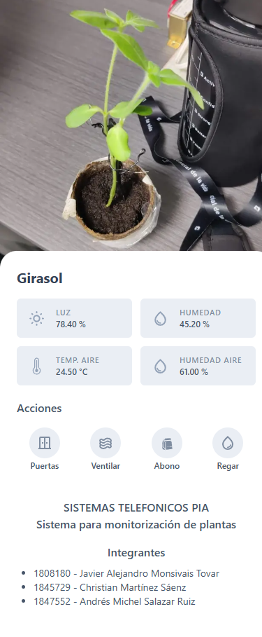
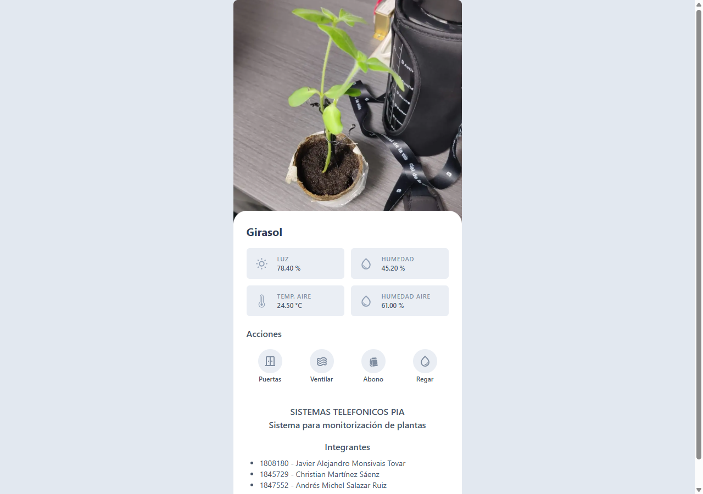

# plants-monitoring-app

Web application for an IoT plant monitoring and care system, developed as the final project (PIA) for the *Sistemas Telefónicos* course of an engineering degree.

The system monitors a plant's environment through sensors connected to an ESP32 and lets the user check its status and act on it remotely. This application is the user-facing layer: it shows the sensor readings in real time and sends the user's actions to the device through a WebSocket server.

<p align="center">
  
</p>

## Project architecture

The solution is split into three repositories, one for each layer of the system:

| Repository | Layer | Description |
| --- | --- | --- |
| [plants-monitoring-esp32](https://github.com/Alejandro095/plants-monitoring-esp32) | Device | ESP32 firmware. Reads the sensors and controls the actuators. |
| [plants-sockets-server](https://github.com/Alejandro095/plants-sockets-server) | Server | WebSocket server. Connects the device with the web clients. |
| [plants-monitoring-app](https://github.com/Alejandro095/plants-monitoring-app) | Client | Web application (this repository). Displays live readings and sends actions to the device. |

```
┌──────────────┐   sensor data (every 2 s)   ┌────────────────┐   live updates   ┌──────────────┐
│    ESP32     │ ──────────────────────────▶ │ Socket server  │ ───────────────▶ │   Web app    │
│  + sensors   │                             │  (Node.js/ws)  │                  │  (Next.js)   │
│  + actuators │ ◀────────────────────────── │                │ ◀─────────────── │              │
└──────────────┘          actions            └────────────────┘   user actions   └──────────────┘
```

All three components communicate over WebSockets on a secure connection (WSS). The server is deployed on [Railway](https://railway.app).

## Features

**Live dashboard.** The app opens a WebSocket connection when the page loads and updates the readings as soon as the server broadcasts them, with no page refresh or polling. Four variables are displayed:

| Variable | Sensor | Unit |
| --- | --- | --- |
| Light | LDR (photoresistor) in a voltage divider | % |
| Soil moisture | Soil moisture probe | % |
| Air temperature | DHT11 | °C |
| Air humidity | DHT11 | % |

Since the server keeps the latest reading in memory, the dashboard shows the current values right after connecting, without waiting for the next sample.

**Remote control.** A set of action buttons lets the user act on the plant's environment from anywhere:

| Button | Action sent | Behavior on the device |
| --- | --- | --- |
| Puertas | `puertas` | Opens/closes the enclosure doors |
| Ventilar | `ventilar` | Toggles the ventilation output on/off |
| Abono | `abono` | Toggles the fertilizer output on/off |
| Regar | `regar` | Turns on the water pump for 4 seconds |

Before sending, the app checks that the connection is open, so a command is never written to a closed socket.

**Mobile-first design.** The interface is built as a mobile app: full screen on phones and a centered, card-style view on larger screens. It is composed of small reusable components (information cards, round action buttons, typography and layout) styled with Tailwind CSS.

<p align="center">
  
</p>

**Multi-user.** Every connected client receives the same broadcast, so several people can watch and control the plant at the same time.

## Message protocol

The system uses its own lightweight plain-text protocol instead of JSON. This keeps message construction and parsing simple on the microcontroller, where memory and processing are limited.

```
origin~action~data
```

- Fields are separated by `~`.
- Multiple values inside `data` are separated by `|`.
- The `origin` prefix indicates who the message is addressed to (`microcontroller` or `client-web`), so each client processes only the messages meant for it.

### Sensor readings (server → web)

Values arrive in this order: light, soil moisture, air temperature, air humidity. The app formats each one to two decimals.

```
client-web~set-data~78.00|45.00|24.50|60.0
```

### Actions (web → server)

```
client-web~set-action~regar
```

The server then forwards the action to the ESP32.

## Tech stack

**Web application (this repository)**
- [Next.js 13](https://nextjs.org/) + React 18
- TypeScript
- [Tailwind CSS](https://tailwindcss.com/)
- [react-icons](https://react-icons.github.io/react-icons/)
- Native browser WebSocket API

**Server**
- Node.js
- ws – WebSocket server
- Railway – deployment

**Device**
- ESP32 programmed with the Arduino framework
- WebSockets_Generic – WebSocket client with SSL, auto-reconnect and heartbeat
- DHTesp – DHT11 sensor reading

## Project structure

```
src/
├── components/
│   ├── element.component.tsx           # Polymorphic base element
│   ├── information-card.component.tsx  # Sensor reading card
│   ├── layout.component.tsx            # Mobile-style page container
│   ├── round-button.component.tsx      # Circular action button
│   ├── text.component.tsx
│   └── title.component.tsx
├── pages/
│   ├── _app.tsx
│   ├── _document.tsx
│   └── index.tsx                       # Dashboard and WebSocket logic
└── styles/
    └── globals.css
```

## Getting started

Requirements: Node.js.

```bash
git clone https://github.com/Alejandro095/plants-monitoring-app.git
cd plants-monitoring-app
npm install
npm run dev
```

Open [http://localhost:3000](http://localhost:3000) in the browser.

The WebSocket server address is set in `src/pages/index.tsx`. To work against a local instance of [plants-sockets-server](https://github.com/Alejandro095/plants-sockets-server), change it to:

```ts
ws.current = new WebSocket('ws://localhost:1234');
```

To build for production:

```bash
npm run build
npm start
```

## Team

- Javier Alejandro Monsivais Tovar
- Christian Martínez Sáenz
- Andrés Michel Salazar Ruiz
